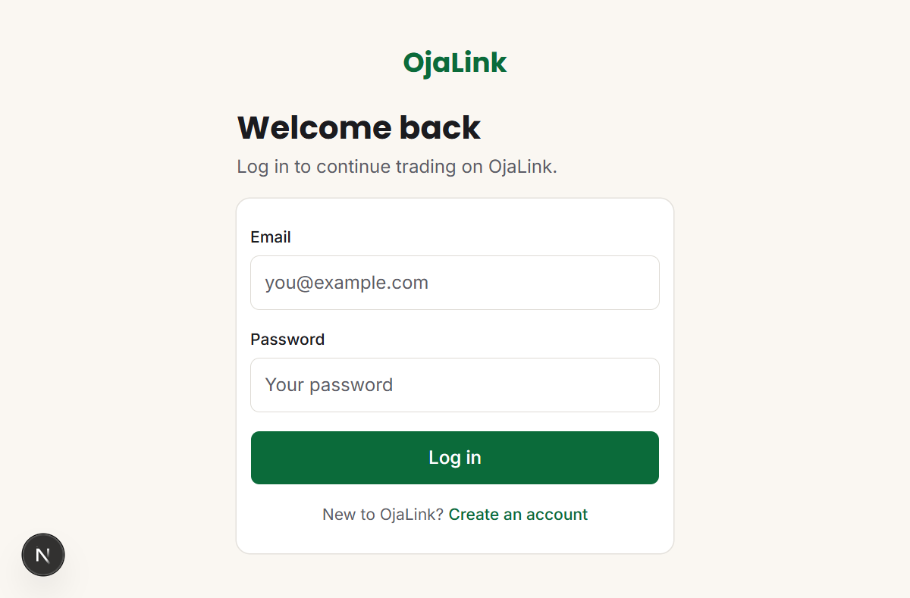
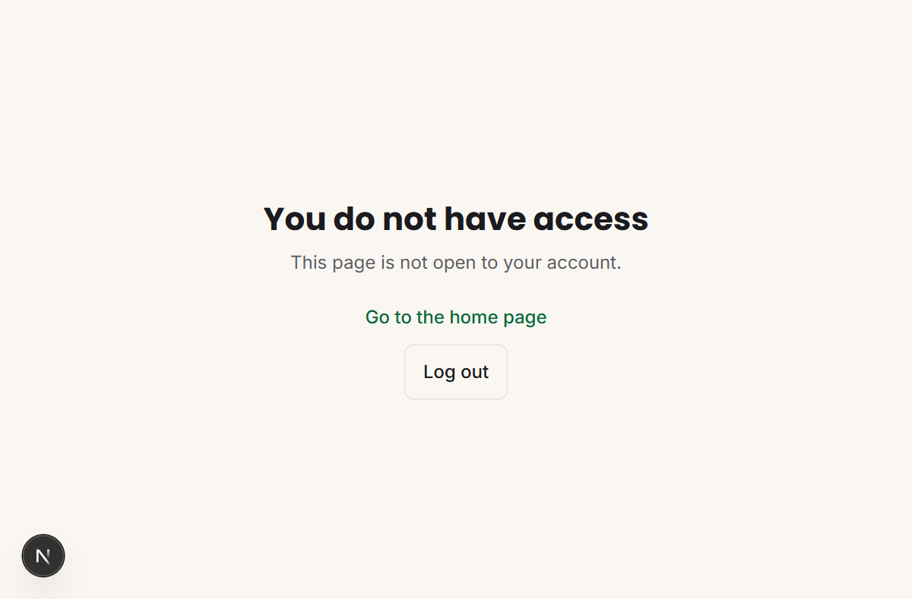
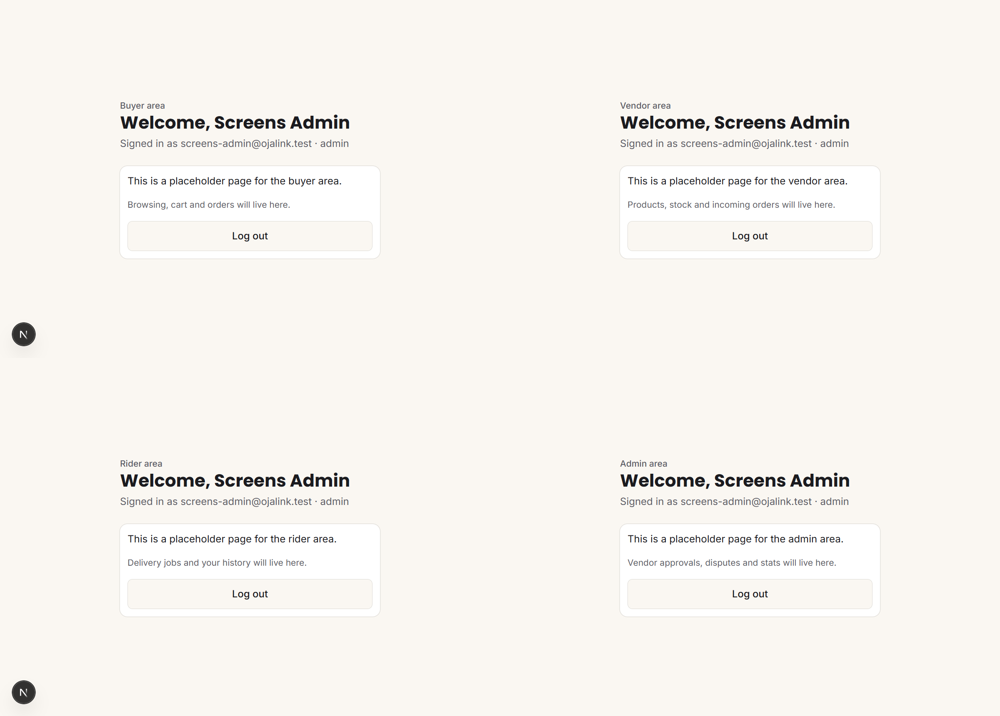

# OjaLink

OjaLink is a phone-first marketplace for Benin City market vendors, buyers,
delivery riders and administrators.

## Foundation

- Next.js App Router with TypeScript, Tailwind CSS and ESLint
- OjaLink’s shared colour, typography, spacing and accessibility defaults
- An empty environment-variable template; never commit `.env` files or API keys
- Working branch: `feature/foundation`

## Database

The PostgreSQL schema is defined in `src/lib/db/schema.ts`. Money is stored as
integer kobo, and each application table uses UUID identifiers plus timestamps.

Generate a reviewed migration with `npm run db:generate`. Only apply a migration
to Neon after the team has approved the schema change:

```bash
npm run db:migrate
```

## Run locally

Copy `.env.example` to `.env.local`, leaving values blank until the relevant
integration is configured. Then install dependencies and run the development server:

```bash
npm install
npm run dev
```

Open [http://localhost:3000](http://localhost:3000). The foundation screen should
show the OjaLink wordmark and brand styling.

## Screenshots

Auth and role guards from `feature/auth-roles`:

| What it shows | Screenshot |
|---|---|
| Signed out, opening `/vendor` redirects to `/login` |  |
| A buyer opening `/admin` gets "You do not have access" (403) |  |
| Admin can open all four areas: `/buyer`, `/vendor`, `/rider`, `/admin` |  |
