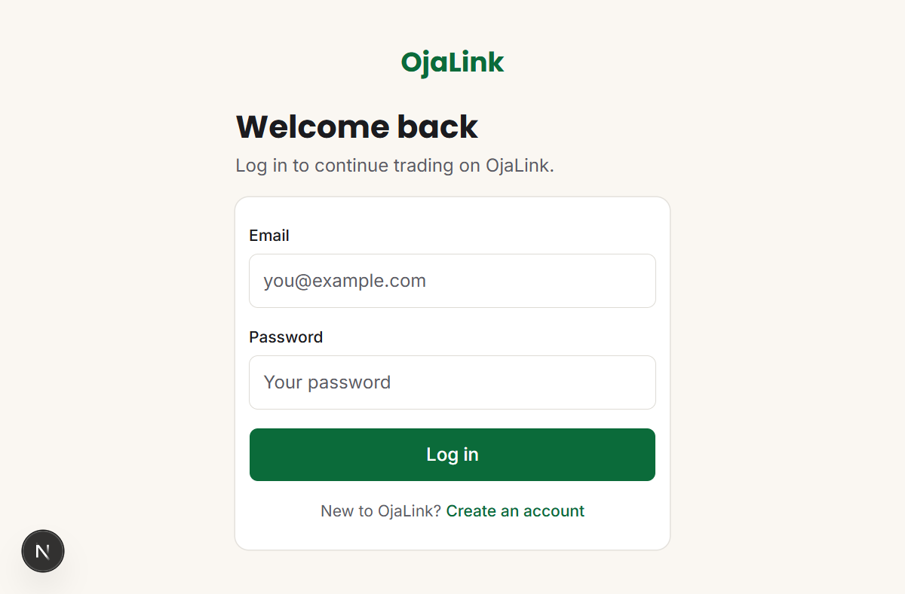
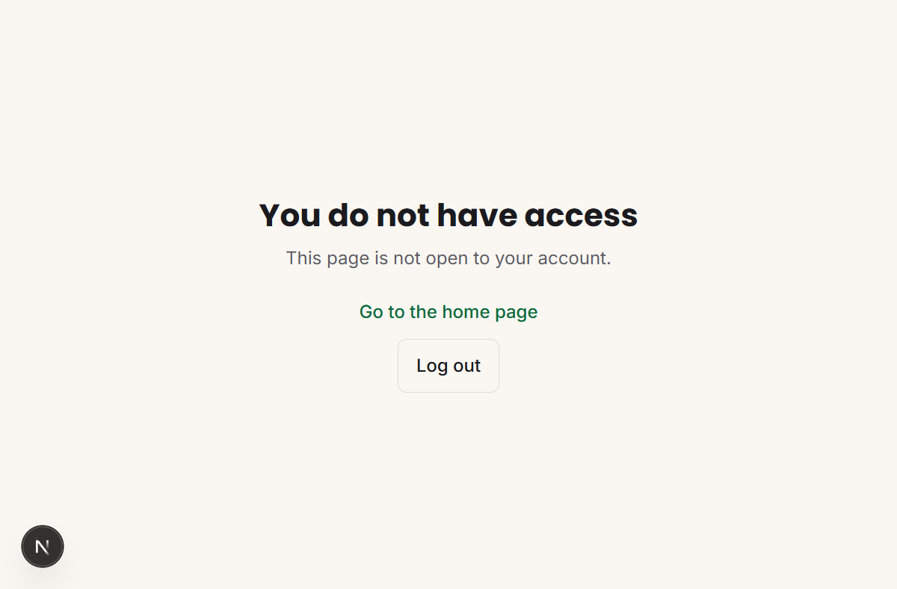
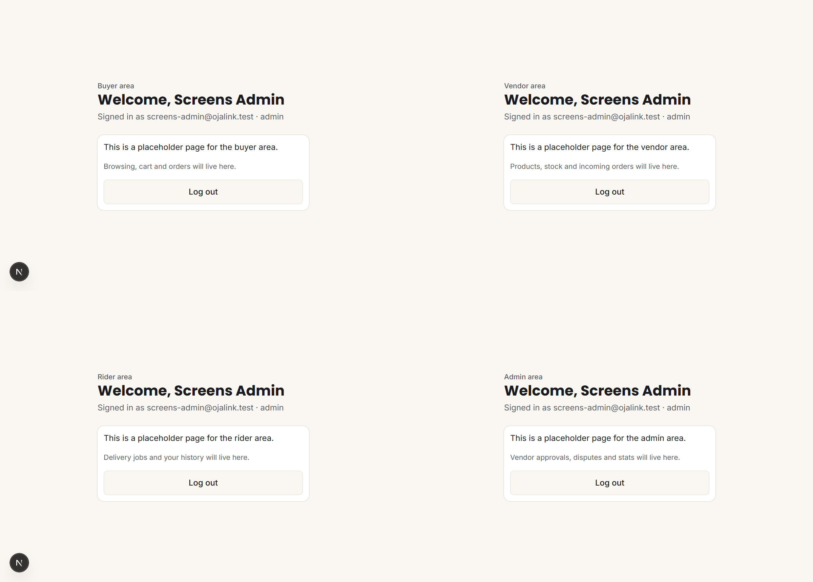
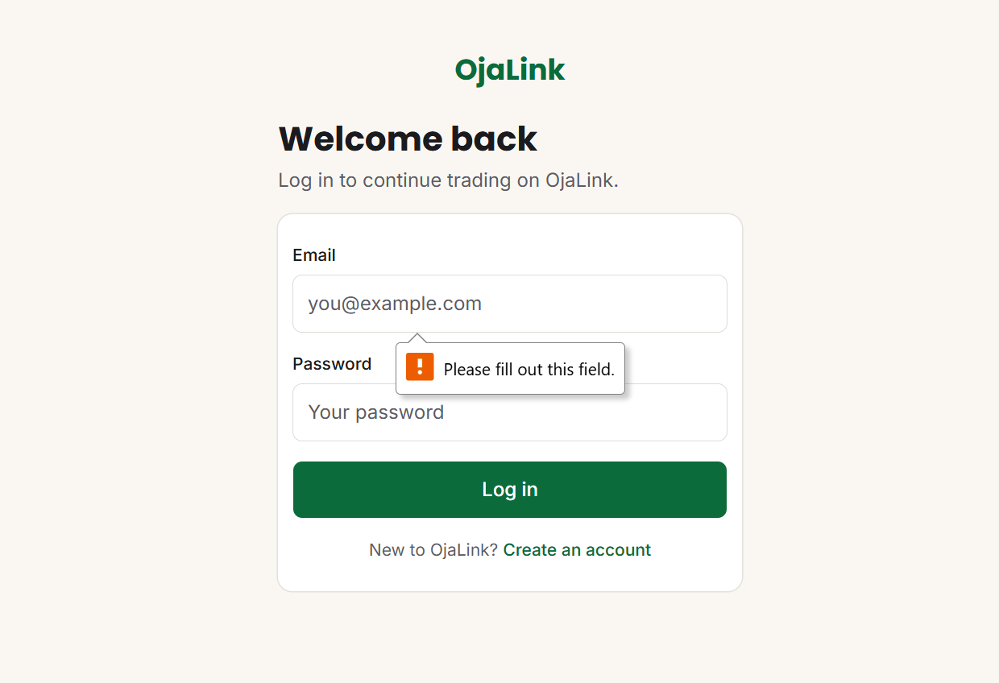
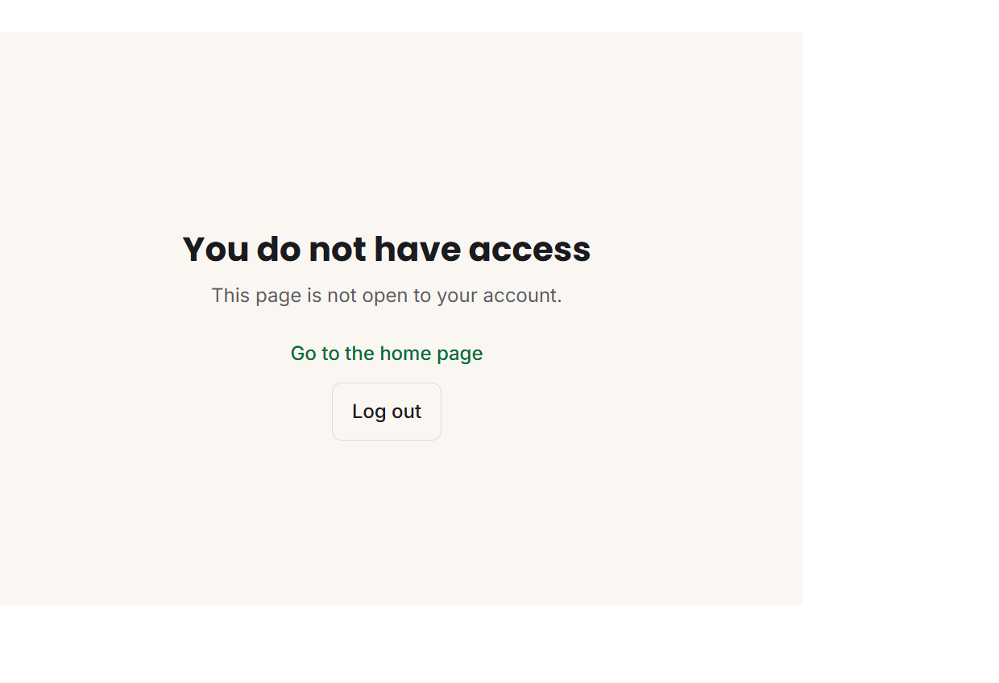
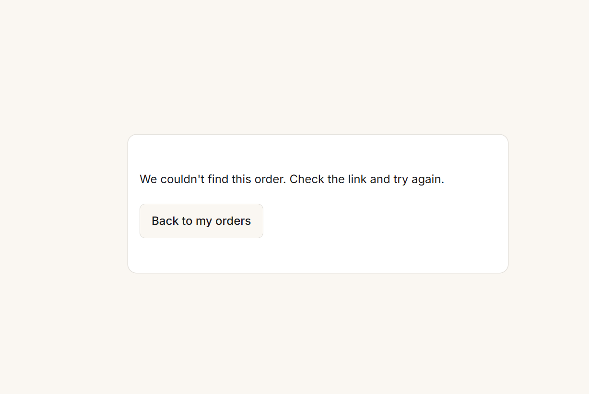

# OjaLink

OjaLink is a phone-first marketplace project for buyers, market vendors, delivery riders and administrators in Benin City, Nigeria.

## Project status

The public home page is the marketplace landing page (PR #12). The current `main` branch includes email-and-password accounts with role-protected areas, vendor product management, vendor order pages, the rider app, the admin area, buyer order tracking, buyer cart and Paystack checkout, the PostgreSQL schema and seed scripts.

- **Feature 1 — Marketplace and search:** merged (PR #12). The public home page and `/marketplace` provide search, category pills and category/shop filters. Only available products from approved vendors are shown. Known limits: there is no result limit yet, and “View product” re-runs a marketplace search because a dedicated product page is not built.
- **Feature 2 — Vendor storefronts:** the owner reports a `/vendors/[slug]` storefront for approved vendors, with shop details, available products and reviews. Work is on `feature/vendor-storefront`; it has not been verified against live Neon data, and no working screenshot is available yet.
- **Feature 3 — Cart and checkout (Edegbe Esohe Favour):** merged (PR #17). Buyers have a single-vendor cart with quantity editing and stock-aware totals, and a Paystack checkout that marks orders paid; reserved stock prevents overselling while an order is unpaid.
- **Feature 4 — Buyer order tracking:** buyers can see their own orders on My orders and open an order to follow payment, accepted, picked up and delivered progress. Cancelled, rejected and refunded orders have clear messages. The owner reports 2/2 automated tests, lint, build and manual status/access checks passing. See [docs/order-tracking.md](docs/order-tracking.md).
- **Feature 5 — Vendor product manager (Michael Iyoha):** merged (PR #3). Vendors manage their own products; creating products requires an approved vendor (pending/rejected vendors are refused server-side). Product photo upload is pending the team’s choice of storage provider. Michael also has team Role 9, Docs & README; see [team contributions](docs/team-contributions.md).
- **Feature 6 — Vendor orders and payouts:** merged (PR #9). Vendors see their own paid orders grouped by status and can accept or reject paid orders with one race-safe conditional update, scoped to their own vendor profile. Weekly payout summaries are not on `main` yet; the `payouts` table and Lagos-week rules are present, but the payout calculation workflow is not built (see [money rules](docs/money-rules.md)).
- **Feature 7 — Rider app (Iyen Monica):** merged (PR #11). Phone-first rider area: available jobs (no buyer contact details until accepted), accept, picked up, delivered and delivery history, all in one transaction per status flip. Iyen's accessibility/mobile reviewer role covers touch target and text sizes, contrast, labels, alt text, slow 3G, 360px screens and Lighthouse checks.
- **Feature 8 — Admin and disputes:** merged (PR #8; label fix PR #13). Admins can approve or reject vendors, review disputes and details, add resolution notes, browse users and view stats. The refund box is disabled; the refund action is not wired yet. The admin guard on every admin page and action was checked by code review, and the committed access screenshots below show the deny/allow screens; full role-switch re-runs against the running app are still on the manual-check list.
- **Feature 10 — Authentication and security:** visitors can sign up, log in and out, and choose buyer, vendor or rider at signup (PR #27); vendor and rider applications are approved by an admin (PR #25), which also gives admins a Users-page role picker. Protected pages and API routes check roles on the server. See [docs/auth.md](docs/auth.md).

Payment checkout and the Paystack webhook are implemented (PR #17). A live deployment URL has not been supplied.

## Technology

- Next.js App Router, React, TypeScript and Tailwind CSS
- Neon serverless PostgreSQL with Drizzle ORM
- Better Auth for accounts and sessions
- Resend integration helper for order status emails (not yet wired into order actions)
- Vitest and ESLint
- Vercel is the planned deployment target; add the live URL after deployment

## Local setup

Requirements: Git, Node.js and npm. Clone the repository and open its folder:

```powershell
git clone https://github.com/victorzahar/Ojalink.git
cd Ojalink
```

On Windows, run the examples below in PowerShell. On macOS or Linux, use your terminal and replace `Copy-Item .env.example .env.local` with `cp .env.example .env.local`. The `npm` commands are the same on all three operating systems.

Create a local environment file and enter the values supplied by the team:

```powershell
Copy-Item .env.example .env.local
```

Never commit `.env.local` or share its values in chat. Install dependencies, apply the migrations, and start the app:

```powershell
npm install
npm run db:migrate
npm run dev
```

Open [http://localhost:3000](http://localhost:3000). Database-backed pages need a valid `DATABASE_URL`. To create throwaway demo accounts, fill the four `SEED_*_PASSWORD` values in `.env.local` and run:

```powershell
npm run db:seed
```

The seed script creates the accounts `admin@ojalink.test`, `buyer@ojalink.test`, `rider@ojalink.test`, and vendor accounts including `vendor@ojalink.test`. Passwords are set locally through the seed environment variables; there are no shared default passwords.

To add the sample order data after seeding:

```powershell
npx tsx src/lib/db/seed-orders.ts
```

## Checks

```powershell
npm test
npm run lint
npm run build
```

The production build requires a valid `DATABASE_URL` in the local environment.

## Current routes

- `/` — marketplace landing page with search, categories and featured vendors
- `/marketplace` — product grid with search, category pills, category/shop filters and filter chips
- `/signup`, `/login` — account creation and login
- `/buyer`, `/vendor`, `/rider`, `/admin` — role-protected areas
- `/orders`, `/orders/[id]` — signed-in buyer’s order list and tracking page
- `/vendor/products`, `/vendor/products/new`, `/vendor/products/[productId]/edit` — vendor product manager (Feature 5, merged)
- `/vendor/orders` — vendor order list grouped by status with accept/reject (Feature 6, merged)
- `/rider`, `/rider/history` — rider jobs and delivery history (Feature 7, merged)
- `/admin/vendors` — vendor approvals (Feature 8, merged)
- `/admin/disputes`, `/admin/disputes/[id]` — dispute list and details (Feature 8, merged)
- `/admin/users` — users list (Feature 8, merged)
- `/admin/stats` — platform statistics (Feature 8, merged)
- `/vendors/[slug]` — Feature 2 work on its branch, not yet integrated into main

A vendor role check is not an ownership check: data queries must also scope records to the vendor profile belonging to the signed-in user. See [docs/auth.md](docs/auth.md).

## Known issues and next work

- Feature 2 needs database tables and sample vendor/product data to be verified against Neon; its owner could not capture a working storefront screenshot.
- Feature 4’s seven order-status email messages are documented in `docs/content-guide.md`, but sending is not wired up and requires the vendor/rider features to call the Resend helper. There is no refunded email yet; the refunded status uses a short message.
- Feature 6’s payout calculation workflow (weekly vendor payouts from the `payouts` table) is not built yet; the schema and Lagos-week rules are in [money rules](docs/money-rules.md).
- Refund money movement still belongs to the future refund workflow; admin disputes cannot set refund status, and the admin refund panel is a disabled placeholder.
- Rider online/offline toggle, proof photos and rider earnings are not built (no schema or team decision yet).
- Feature 10’s production rate limiting is stored in memory, which is weak for Vercel. Sign-up currently reveals whether an email is registered. Google login is not built. The admin role-management screen is built (PR #25: Users-page role picker plus the vendor-approval and rider-request queues), and buyers choose vendor or rider at signup (PR #27).
- The owner reports the buyer-to-buyer order refusal test passed manually (we have not re-run it ourselves; it would need a second buyer account, `buyer2@ojalink.test`, which the seed does not create yet). Vendor-to-vendor data refusal still needs a manual check with two vendor accounts.
- docs/money-rules.md still needs its payouts-section correction — the rules PR merged before the corrected payout wording was agreed.
- The payouts-and-refunds migration work is still pending on the project checklist; do not test refund flows before the migration state is confirmed.
- The seed scripts do not yet create the second accounts (`buyer2@ojalink.test`, `rider2@ojalink.test`) used for cross-account access checks.
- The PR #4 follow-ups are still open: a buyer-scope automated test, a production guard in `seed-orders.ts`, and removing the “TEMPORARY” note.
- Feature 5 photo upload awaits the team’s storage-provider decision.
- The live URL is https://ojalink-iota.vercel.app. All feature owners and commit links are now filled in on the roster.

## Environment variables

The names and explanations are in [.env.example](.env.example): `DATABASE_URL`, `BETTER_AUTH_URL`, `BETTER_AUTH_SECRET`, the four optional `SEED_*_PASSWORD` demo-account passwords, and `RESEND_API_KEY` / `EMAIL_FROM` for when email sending is wired up. Better Auth reads `BETTER_AUTH_SECRET` (or `AUTH_SECRET`) by default and requires a configured secret in production ([setup guidance](https://better-auth.com/docs/installation)). Generate a high-entropy secret locally (for example with `openssl rand -base64 32`) and use a different one on Vercel. Resend values are only needed when email sending is wired up.

## Project documentation

- [Authentication and access rules](docs/auth.md)
- [Order tracking](docs/order-tracking.md)
- [Money, refunds and payouts rules](docs/money-rules.md)
- [Content guide](docs/content-guide.md)
- [Team contributions and hand-in checklist](docs/team-contributions.md)

## Screenshots

Current access-control and order-tracking evidence:

| Evidence | Screenshot |
|---|---|
| Signed-out visitor opening `/vendor` is redirected to login |  |
| Buyer opening `/admin` is denied |  |
| Composite of four screenshots: admin opened all four role areas |  |
| Signed-out visitor opening orders is sent to login |  |
| Vendor cannot view another buyer’s order |  |
| Buyer cannot view another buyer’s order; page says not found |  |
