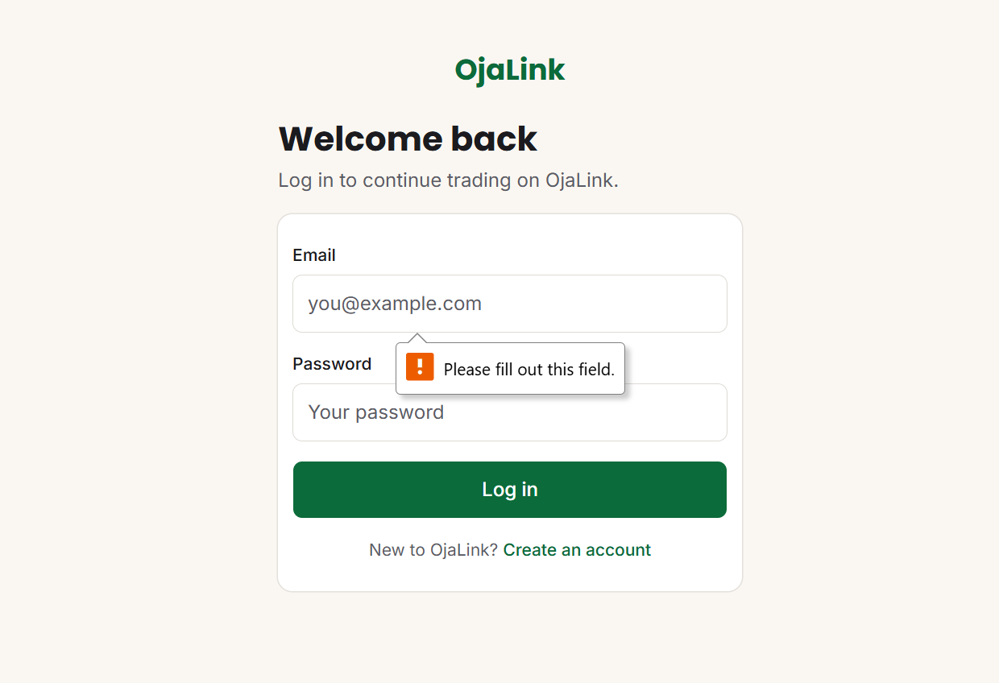
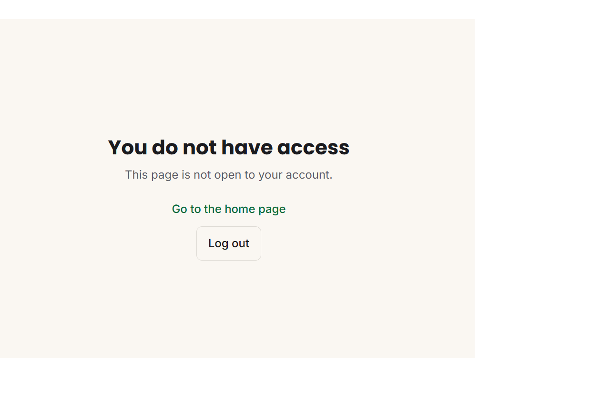
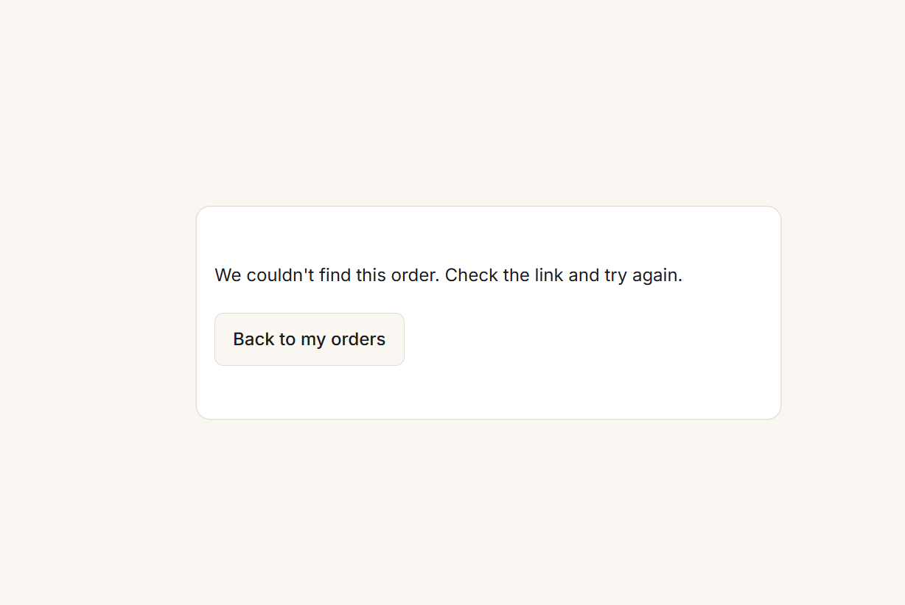

# OjaLink

OjaLink is a phone-first marketplace project for buyers, market vendors, delivery riders and administrators in Benin City, Nigeria.

## Project status

The current `main` branch includes email-and-password accounts with role-protected areas, buyer order tracking, the PostgreSQL schema and seed scripts. The public home page is still a foundation screen.

- **Feature 1 — Marketplace and search:** not started on `main`; awaiting confirmation and a screenshot from its owner.
- **Feature 4 — Buyer order tracking:** buyers can see their own orders on My orders and open an order to follow payment, accepted, picked up and delivered progress. Cancelled, rejected and refunded orders have clear messages. The owner reports 2/2 automated tests, lint, build, manual status checks and refused-access checks passing. See [docs/order-tracking.md](docs/order-tracking.md).
- **Feature 5 — Vendor product manager:** being completed on branch `feature/vendor-products` / PR #3. Product photo upload is pending the team’s choice of storage provider.
- **Feature 10 — Authentication and security:** visitors can sign up, log in and out. Protected pages and API routes check roles on the server. See [docs/auth.md](docs/auth.md).

Payment checkout and the Paystack webhook are not yet implemented in this repository. A live deployment URL has not been supplied.

## Technology

- Next.js App Router, React, TypeScript and Tailwind CSS
- Neon serverless PostgreSQL with Drizzle ORM
- Better Auth for accounts and sessions
- Resend integration helper for order status emails (not yet wired into order actions)
- Vitest and ESLint
- Vercel is the planned deployment target; add the live URL after deployment

## Local setup

Requirements: Git, Node.js and npm. Clone the repository and open its folder:

```powershell
git clone https://github.com/victorzahar/Ojalink.git
cd Ojalink
```

Create a local environment file and enter the values supplied by the team:

```powershell
Copy-Item .env.example .env.local
```

Never commit `.env.local` or share its values in chat. Install dependencies, apply the migrations, and start the app:

```powershell
npm.cmd install
npm.cmd run db:migrate
npm.cmd run dev
```

Open [http://localhost:3000](http://localhost:3000). Database-backed pages need a valid `DATABASE_URL`. To create throwaway demo accounts, fill the four `SEED_*_PASSWORD` values in `.env.local` and run:

```powershell
npm.cmd run db:seed
```

The seed script creates the accounts `admin@ojalink.test`, `buyer@ojalink.test`, `rider@ojalink.test`, and vendor accounts including `vendor@ojalink.test`. Passwords are set locally through the seed environment variables; there are no shared default passwords.

To add the sample order data after seeding:

```powershell
npx tsx src/lib/db/seed-orders.ts
```

## Checks

```powershell
npm.cmd test
npm.cmd run lint
npm.cmd run build
```

The production build requires a valid `DATABASE_URL` in the local environment.

## Current routes

- `/` — foundation home screen
- `/signup`, `/login` — account creation and login
- `/buyer`, `/vendor`, `/rider`, `/admin` — role-protected areas
- `/orders`, `/orders/[id]` — signed-in buyer’s order list and tracking page
- `/vendor/products` and its new/edit pages — Feature 5, pending merge of PR #3

A vendor role check is not an ownership check: data queries must also scope records to the vendor profile belonging to the signed-in user. See [docs/auth.md](docs/auth.md).

## Known issues and next work

- Feature 4’s seven order-status email messages are documented in `docs/content-guide.md`, but sending is not wired up and requires the vendor/rider features to call the Resend helper. There is no refunded email yet; the refunded status uses a short message.
- Feature 10’s production rate limiting is stored in memory, which is weak for Vercel. Sign-up currently reveals whether an email is registered. Google login and an admin role-management screen are not built.
- The owner reports the buyer-to-buyer order refusal test passed manually. Vendor-to-vendor data refusal still needs a manual check with two vendor accounts.
- Feature 5 photo upload awaits the team’s storage-provider decision.
- The live URL and the remaining team member names and commit links still need to be added.

## Environment variables

The names and explanations are in [.env.example](.env.example). Optional seed passwords create throwaway local demo accounts. Resend values are only needed when email sending is wired up.

## Project documentation

- [Authentication and access rules](docs/auth.md)
- [Order tracking](docs/order-tracking.md)
- [Money, refunds and payouts rules](docs/money-rules.md)
- [Content guide](docs/content-guide.md)
- [Team contributions and hand-in checklist](docs/team-contributions.md)

## Screenshots

Current access-control and order-tracking evidence:

| Evidence | Screenshot |
|---|---|
| Signed-out visitor opening `/vendor` is redirected to login |  |
| Buyer opening `/admin` is denied |  |
| Composite of four screenshots: admin opened all four role areas |  |
| Signed-out visitor opening orders is sent to login |  |
| Vendor cannot view another buyer’s order |  |
| Buyer cannot view another buyer’s order; page says not found |  |
